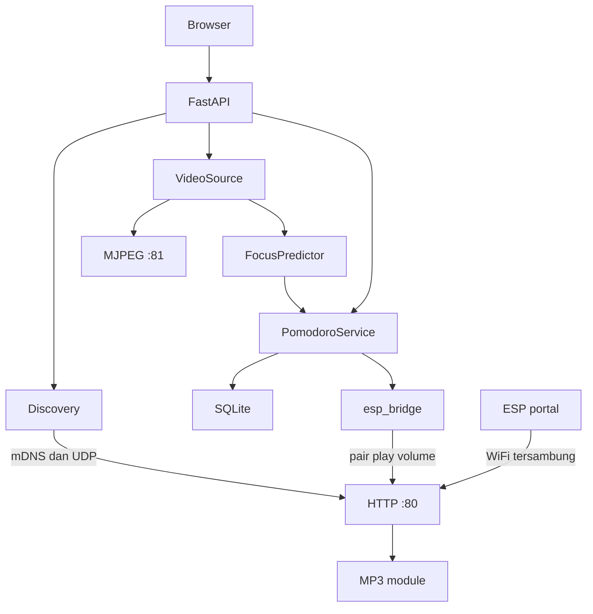

# Firmware NARA — ESP32-S3-CAM + DFPlayer Mini

NARA memantau atensi belajar di laptop, menjalankan timer Pomodoro di server, dan memakai ESP32-S3 sebagai kamera jaringan plus pengeras suara. Firmware di folder ini hanya mengurus dua hal: stream MJPEG dan memutar file MP3 di modul DFPlayer Mini. Keputusan fokus, timer, dan kapan suara diputar ada di aplikasi Python.

File suara ada di **kartu SD milik modul MP3**, bukan di slot SD ESP32. Kalau modul MP3 tidak ACK, stream kamera tetap jalan.

Buka folder ini di Arduino IDE lewat `nara_esp32s3.ino`. File `config.h`, `nara_stream.cpp`, dan `nara_stream.h` harus satu folder dengan sketch. `nara_stream.cpp` dipisah karena `WiFiManager` dan `esp_http_server` sama-sama mendefinisikan `HTTP_GET`; digabung dalam satu file, kompilasi gagal.

Sebelum flash, cocokkan pin di `config.h` dengan skema board. Salah pin kamera membuat `esp_camera_init` gagal. Salah pin UART membuat suara diam, tetapi stream kamera tetap jalan.

## Tech stack

| Lapisan | Yang dipakai |
| --- | --- |
| UI laptop | Browser, template Jinja2, WebSocket |
| Server | FastAPI, Uvicorn, Pydantic |
| Visi | OpenCV, MediaPipe Face Landmarker, scikit-learn (SVM), joblib, NumPy |
| Sesi | `PomodoroService`, SQLite (`sqlite3`, berkas `pomodoro_sessions.db`) |
| Discovery | zeroconf (mDNS `_nara._tcp`), UDP `NARA_DISCOVER` |
| Jembatan suara | httpx di `esp_bridge.py`, token di `settings.json` |
| Firmware | Arduino-ESP32: WiFiManager, DFRobotDFPlayerMini, `esp_camera`, ESPmDNS, ArduinoJson, Preferences, `WebServer` (port 80), `esp_http_server` (port 81) |

Pelatihan model (di luar jalur runtime) memakai matplotlib, seaborn, dan pandas lewat `train_svm.py`.

## Struktur repo

```
project-nara/
├── app.py                      # python app.py  ->  web_dashboard/app.py
├── cv_focus_engine.py          # VideoSource, metrik wajah
├── focus_predictor.py          # FocusPredictor (SVM)
├── pomodoro_service.py         # timer dan empat event suara
├── device_discovery.py         # mDNS + UDP 4210
├── esp_bridge.py               # POST /pair, /play, /volume
├── settings_store.py           # settings.json
├── requirements.txt
├── web_dashboard/
│   ├── app.py                  # FastAPI, host default 127.0.0.1:8000
│   ├── templates/index.html
│   └── static/
└── firmware/nara_esp32s3/
    ├── nara_esp32s3.ino
    ├── config.h
    ├── nara_stream.cpp
    ├── nara_stream.h
    └── README.md
```

## Arsitektur



Browser hanya bicara ke FastAPI di laptop. FastAPI menarik JPEG dari port 81, `FocusPredictor` mengklasifikasi fokus, dan `PomodoroService` memajukan timer lalu menulis sesi ke SQLite. Event suara masuk antrean `esp_bridge`, yang memanggil port 80. Portal WiFiManager hanya untuk mengisi SSID; setelah STA terhubung dan portal tutup, server kontrol mengambil port 80.

## Alur runtime

1. ESP belum punya kredensial WiFi: captive portal, SSID `NARA-Setup-XXXX`, terbuka, tanpa sandi. XXXX adalah 4 digit hex **dua oktet terakhir MAC STA**, huruf besar. Contoh MAC berakhir `A1:B2` menjadi `NARA-Setup-A1B2`.
2. Setelah join WiFi rumah, ESP mengumumkan diri. Hostname `nara-cam-a1b2.local` (huruf kecil). mDNS service `_nara._tcp` port 80, TXT `id`, `stream_port`=`"81"`, `fw`=`1.0.0`. UDP port **4210** membalas datagram ASCII `NARA_DISCOVER`.
3. Di laptop, dari root repo: `python app.py` (atau `python web_dashboard/app.py`). Default bind `127.0.0.1`, port **8000**. Buka `http://127.0.0.1:8000`.
4. Layar utama memuat kamera lewat `GET /api/cameras` (webcam 0–3 dan ESP yang ditemukan). Pilih perangkat NARA; itu `POST /api/camera/select`. Sumber video menjadi `http://<ip>:81/stream`.
5. `esp_bridge` memanggil `POST /pair` **sekali**, hanya jika `settings.json` belum menyimpan token untuk `id` perangkat itu. Jawaban `{"token":"<32 hex>"}` disimpan di `tokens`. Pemanggilan berikutnya memakai token yang sama. Kalau kamera terakhir di settings berjenis ESP, pairing juga dicoba saat aplikasi mulai.
6. `VideoSource` membaca MJPEG. `FocusPredictor` mengolah frame. `pomodoro_tick_loop` memanggil `tick()` sekitar 1 Hz, termasuk saat kamera tidak diproses selama istirahat.
7. Empat event suara (`SESSION_START`, `UNFOCUSED`, `BREAK_END`, `SESSION_END`) dikirim `POST /play` bila audio menyala. Tes suara di UI (`POST /api/audio/test`) memaksa track `SESSION_START` meski audio sesi dimatikan.

Endpoint laptop yang dipakai alur ini: `GET /`, `GET /video_feed`, WebSocket `/ws`, `GET /api/cameras`, `POST /api/camera/select`, `POST /api/devices/rescan`, `POST /api/devices/manual` (probe `GET /info`), `POST /api/audio/config`, `POST /api/audio/test`, `POST /api/pomodoro/start`, `pause`, `resume`, `reset`, `end`, `skip`, `accept_break`, `dismiss_alert`, `configure`.

Firewall laptop perlu mengizinkan mDNS (UDP 5353) dan UDP 4210. Kalau klien di jaringan tidak saling melihat, isi IP manual; app mengambil `GET /info`.

## Empat event suara

Folder `/01` = bahasa `id`, folder `/02` = bahasa `en`. Track dipanggil lewat `playFolder(folder, track)`.

| Event | Kapan dikirim server | File |
| --- | --- | --- |
| `SESSION_START` | Mulai mode STUDY; timer BREAK atau LONG_BREAK habis; skip dari istirahat ke STUDY | `001.mp3` |
| `UNFOCUSED` | Hanya saat STUDY berjalan. Tidak fokus (label tidak fokus atau wajah hilang) bertahan 15 detik, atau flag tidur dari predictor bertahan 3 detik. Cooldown 30 detik sejak event UNFOCUSED terakhir | `002.mp3` |
| `BREAK_END` | Timer BREAK atau LONG_BREAK sampai nol. Setelah itu server juga mengantre `SESSION_START` | `003.mp3` |
| `SESSION_END` | Timer STUDY sampai nol, atau pengguna mengakhiri sesi saat mode masih STUDY | `004.mp3` |

Skip saat STUDY, mengakhiri sesi saat istirahat, dan menerima saran istirahat tidak mengirim event suara.

`esp_bridge` mengosongkan antrean sekaligus. `UNFOCUSED` yang umurnya lebih dari **5 detik** dibuang. Kalau batch yang sama berisi event lain, semua `UNFOCUSED` di batch itu dibuang. Urutan putar: `SESSION_END`, lalu `BREAK_END`, lalu `SESSION_START`, lalu `UNFOCUSED`. Nama event yang sama hanya menyisakan stempel waktu terbaru.

Flag tidur di mesin visi menyala setelah mata tertutup sekitar 1 detik. Penghitung 3 detik di `PomodoroService` baru mulai setelah flag itu benar, jadi suara tidur tidak berbunyi pada kedipan singkat.

Volume default di NVS firmware adalah 18 (rentang 0–30). Default di `settings.json` adalah 20; setelah paired, laptop mendorong nilai itu lewat `POST /volume`.

## Kontrak HTTP, UDP, dan mDNS

Stream: `GET http://<ip>:81/stream`  
`Content-Type: multipart/x-mixed-replace;boundary=naraframe`  
Satu klien (`max_open_sockets` 1, LRU purge). Koneksi baru menendang klien lama. Jangan membuka URL ini di browser bersamaan dengan app Python yang sedang menarik frame. Kalau `esp_camera_init` gagal, handler membalas 500 teks `camera init failed`.

Kontrol di port 80. Body dibaca sebagai JSON (`server.arg("plain")`). `POST /play` dan `POST /volume` wajib header `X-NARA-Token`. `GET /info`, `GET /status`, UDP, dan stream tidak memakai token.

`GET /info` → 200

```json
{"id":"nara-cam-a1b2","name":"NARA Cam A1B2","fw":"1.0.0","paired":false,"stream_port":81}
```

`POST /pair` tanpa header. Berhasil hanya jika **belum ada token** dan permintaan datang dalam **120 detik sejak server kontrol hidup** (`servicesStartedMs`). Waktu di AP `NARA-Setup-…` tidak dihitung. Server kontrol baru bind setelah WiFi STA terhubung, portal setup sudah tutup, dan jeda 300 ms.

200: `{"token":"<32 hex>"}`. Token disimpan di NVS dan hanya dikirim di jawaban ini.

403: `{"error":"already_paired"}` jika token sudah ada, atau `{"error":"pairing_window_closed"}` jika jendela sudah lewat.

Reboot saat sudah paired tidak membuka jendela pairing lagi. Tahan tombol GPIO47 selama 5 detik untuk menghapus kredensial WiFi dan token, lalu ESP restart ke portal setup. Bahasa dan volume di NVS tidak dihapus. Setelah ESP join WiFi lagi, app harus `POST /pair` dalam 120 detik.

`POST /play` dengan header `X-NARA-Token`.

```json
{"lang":"id","event":"UNFOCUSED"}
```

`lang` hanya `id` (folder 1) atau `en` (folder 2).  
`event` hanya `SESSION_START` (track 1), `UNFOCUSED` (2), `BREAK_END` (3), `SESSION_END` (4).

200:

```json
{"ok":true,"lang":"id","event":"UNFOCUSED","folder":1,"track":2}
```

Bahasa ditulis ke NVS sebelum perintah play. `last_event` baru terisi setelah `playFolder` dipanggil. 200 berarti perintah UART dikirim setelah modul ACK, bukan konfirmasi bahwa file selesai diputar.

`POST /volume`

```json
{"volume":18}
```

Angka 0–30, sama dengan rentang DFPlayer. 200: `{"ok":true,"volume":18}`. Nilai disimpan di NVS lalu dikirim ke modul.

`GET /status` → 200

```json
{"wifi":true,"ip":"192.168.1.20","paired":true,"volume":18,"last_event":"UNFOCUSED","lang":"id","mp3_ok":true}
```

`wifi` boolean. `last_event` string kosong sampai `/play` benar-benar memanggil modul. `volume` adalah nilai yang disimpan, bukan baca-ulang dari chip. App menanyakan `/status` kira-kira setiap 10 detik.

Kesalahan lain:

| Kode | `error` |
| --- | --- |
| 400 | `bad_json`, `bad_lang`, `bad_event`, `bad_volume` |
| 403 | `unauthorized` pada `/play` dan `/volume` (belum paired, header hilang, atau token salah) |
| 404 | `not_found` |
| 503 | `mp3_unavailable` |
| 500 | `response_too_big` jika JSON jawaban tidak muat di buffer |

UDP 4210, balasan ke IP dan port pengirim. Datagram harus persis `NARA_DISCOVER` (spasi dan newline di ujung diabaikan):

```json
{"id":"nara-cam-a1b2","name":"NARA Cam A1B2","ip":"192.168.1.20","stream_port":81,"paired":false}
```

mDNS: `MDNS.addService("nara", "tcp", 80)`. TXT `id`, `stream_port` (string `"81"`), `fw` (`1.0.0`). Di JSON, `stream_port` angka. Balasan UDP tidak memuat `fw`. `GET /info` tidak memuat `ip`.

Kalau modul MP3 tidak ACK, serial mencatatnya dan server kamera tetap jalan. `/play` dan `/volume` membalas 503 tanpa mereset ESP. Keduanya boleh mencoba `begin()` lagi pada permintaan berikutnya.

## Pin default

| Fungsi | GPIO | Arah |
| --- | --- | --- |
| UART TX ke DFPlayer RX | **21** | ESP mengirim |
| UART RX dari DFPlayer TX | **14** | ESP menerima |
| Tombol reset pabrik | **47** | ke GND, active LOW, tahan 5 detik |

Map kamera default (`NARA_CAMERA_BOARD 1`) adalah **ESP32-S3-CAM / Freenove ESP32-S3-CAM**. Pin kameranya sama dengan **ESP32-S3-EYE**, tetapi board EYE sering memakai GPIO21 dan GPIO47 untuk LCD. Jangan pakai pin default itu pada EYE sebelum skema dicek.

`NARA_CAMERA_BOARD 3` adalah **Seeed XIAO ESP32S3 Sense** (pin kamera berbeda). Pada XIAO, GPIO14 dan GPIO47 dipakai kamera. Pindahkan dulu ke `MP3_UART_TX 1`, `MP3_UART_RX 2`, `RESET_BUTTON_PIN 4`, kalau tidak sketch ditolak `static_assert`.

Bukan map board **ESP32-S3-CAM-LCD** (XCLK di GPIO40). Kalau skema Anda berbeda, salin pin kameranya ke blok di `config.h`.

Jangan memakai pin ini untuk UART atau tombol:

- Kamera (board 1): GPIO 4, 5, 6, 7, 8, 9, 10, 11, 12, 13, 15, 16, 17, 18
- Strapping: GPIO 0 (BOOT), 3, 45, 46
- USB native: GPIO 19 dan 20
- UART0 / serial monitor: GPIO 43 dan 44
- Flash/PSRAM internal modul WROOM: GPIO 26–32 (sering tidak keluar di header)
- Slot microSD onboard Freenove (1-bit): GPIO 38, 39, 40 — jangan dipasang UART di situ walau firmware tidak me-mount SD ESP

Tombol adalah saklar momentary antara GPIO47 dan GND. Pull-up internal menyala. Jangan pakai pin EN/RST board (reset keras, firmware tidak menghitung 5 detik). Jangan pakai BOOT/GPIO0 kecuali definisi diubah: tombol itu ditahan saat boot akan masuk mode download.

## Wiring DFPlayer Mini

Modul bergaya DFPlayer Mini, UART 9600 8N1.

| ESP32-S3 | Modul MP3 |
| --- | --- |
| GPIO21 (TX) | RX (pin 2) |
| GPIO14 (RX) | TX (pin 3), lewat pembagi resistor jika TX modul 5V |
| GND | GND (pin 7), wajib satu ground dengan ESP |
| — | VCC (pin 1) = 5V |
| — | Speaker di SPK1 (pin 6) dan SPK2 (pin 8), bukan ke GND |

TX ESP 3,3V biasanya langsung diterima RX modul. TX modul yang idle di 5V tidak boleh masuk GPIO ESP. Ukur pin TX modul: kalau 5V, pasang pembagi, misalnya 1k dari TX modul ke GPIO14 dan 2k dari GPIO14 ke GND (sekitar 3,3V). Banyak klon sudah 3,3V di pin TX; pembagi tetap aman.

## Catu daya

Kamera plus speaker mudah brownout (ESP restart berulang) kalau hanya di-USB laptop.

- Pakai catu **5V 2A terpisah**.
- Pasang kapasitor **470µF** (atau lebih besar, rating minimal 10V) menempel di VCC dan GND modul MP3.
- Ground ESP, catu, dan modul harus menyatu.
- Jangan mengandalkan USB saja saat speaker dan kamera dipakai bersamaan.

Kalau pin 5V board tersambung langsung ke VBUS USB, jangan mencampur USB dan 5V eksternal sekaligus (bisa mengalir balik ke laptop). Flash lewat USB, lalu saat operasi pakai catu 5V dengan USB dicabut, atau beri daya hanya dari satu sumber.

## Kartu SD modul MP3

Format FAT32. Nama file harus tiga digit, sesuai yang diminta DFPlayer.

```
/01/001.mp3   SESSION_START   Indonesia
/01/002.mp3   UNFOCUSED
/01/003.mp3   BREAK_END
/01/004.mp3   SESSION_END
/02/001.mp3   SESSION_START   English
/02/002.mp3   UNFOCUSED
/02/003.mp3   BREAK_END
/02/004.mp3   SESSION_END
```

Tidak ada file audio di SD ESP.

## Arduino IDE

1. Boards Manager URL: `https://espressif.github.io/arduino-esp32/package_esp32_index.json`
2. Pasang paket **esp32 by Espressif Systems** (2.0.14+ atau 3.x).
3. Library Manager:
   - WiFiManager by tzapu (2.0.x)
   - DFRobotDFPlayerMini by DFRobot
   - ArduinoJson by Benoit Blanchon (6 atau 7; sketch menerima keduanya)
4. Board: **ESP32S3 Dev Module** (bukan "ESP32 Dev Module").
5. PSRAM: **OPI PSRAM** untuk modul N8R8 / N16R8 yang umum pada ESP32-S3-CAM dan Freenove. Kalau init kamera gagal dengan PSRAM terpasang, coba **QSPI PSRAM**.
6. Flash Size: samakan dengan marking modul (sering 8MB atau 16MB). Salah ukuran flash membuat boot gagal.
7. Partition Scheme: **Huge APP (3MB No OTA)** kalau opsi itu ada. Sketch kamera + WiFiManager butuh partisi APP yang besar.
8. USB CDC On Boot: **Disabled** jika board punya chip USB-UART (CH340/CP2102, umum di Freenove) dan Anda membuka serial lewat COM port chip itu. **Enabled** jika board hanya punya USB native (GPIO19/20) dan tidak ada chip serial.
9. Upload 921600, monitor 115200.

Serial akan mencetak `board=1`, pin UART/tombol, nama AP, lalu IP. Tidak ada log kamera biasanya berarti PSRAM atau USB CDC belum cocok, bukan berarti sketch salah folder.

Ukuran frame default **QVGA** (`FRAMESIZE_QVGA` di `nara_esp32s3.ino`). Untuk VGA, ubah `NARA_FRAME_SIZE` menjadi `FRAMESIZE_VGA`. `NARA_JPEG_QUALITY` 12: angka lebih kecil = gambar lebih besar dan lebih tajam. Tanpa PSRAM, firmware memaksa QVGA, kualitas 16, satu buffer di DRAM.
