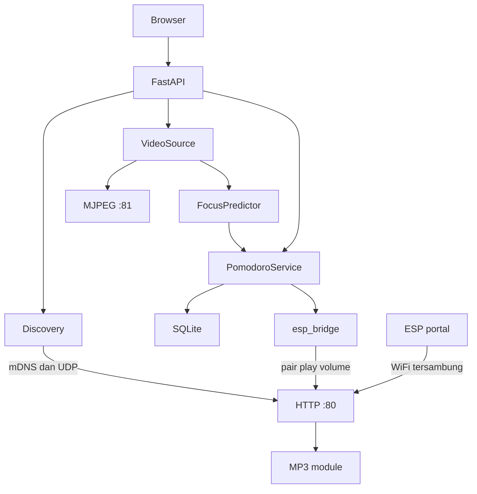

# Firmware NARA — ESP32-S3-CAM + DFPlayer Mini

NARA memantau atensi belajar di laptop, menjalankan timer Pomodoro di server, dan memakai ESP32-S3 sebagai kamera jaringan plus pengeras suara. Firmware di folder ini hanya mengurus dua hal: stream MJPEG dan memutar file MP3 di modul DFPlayer Mini. Keputusan fokus, timer, dan kapan suara diputar ada di aplikasi Python.

File suara ada di **kartu SD milik modul MP3**, bukan di slot SD ESP32. Kalau modul MP3 tidak ACK, stream kamera tetap jalan.

Buka folder ini di Arduino IDE lewat `nara_esp32s3.ino`. File `config.h`, `nara_stream.cpp`, dan `nara_stream.h` harus satu folder dengan sketch. `nara_stream.cpp` dipisah karena `WiFiManager` dan `esp_http_server` sama-sama mendefinisikan `HTTP_GET`; digabung dalam satu file, kompilasi gagal.

Sebelum flash, cocokkan pin di `config.h` dengan skema board. Salah pin kamera membuat `esp_camera_init` gagal. Salah pin UART membuat suara diam, tetapi stream kamera tetap jalan.

---

## 🚀 Panduan Cepat: 5 Langkah Menjalankan Firmware di ESP32-S3

Ikuti 5 langkah praktis ini untuk mengonfigurasi, mengunggah, dan mencoba ESP32-S3 langsung ke sistem NARA:

### Langkah 1: Atur Wi-Fi di `config.h`
Buka file `config.h` di Arduino IDE:
```cpp
// 1 = Hubungkan langsung ke WiFi rumah / Hotspot HP (Sangat direkomendasikan untuk uji coba cepat)
// 0 = Gunakan WiFiManager Captive Portal (Access Point NARA-Setup-XXXX)
#define USE_DIRECT_WIFI 1

#if USE_DIRECT_WIFI
#define WIFI_SSID "NAMA_WIFI_KAMU"        // Masukkan SSID WiFi / Hotspot kamu
#define WIFI_PASS "PASSWORD_WIFI_KAMU"    // Masukkan Password WiFi kamu
#endif
```
*(Jika koneksi langsung gagal atau belum diatur, firmware otomatis beralih ke captive portal WiFiManager).*

### Langkah 2: Wiring DFPlayer Mini & Pin Kamera
Pada board **ESP32-S3-CAM / Freenove ESP32-S3-CAM** (`NARA_CAMERA_BOARD 1`):
* **ESP TX (GPIO 21)** $\rightarrow$ **RX DFPlayer Mini** (lewat resistor 1kΩ bila perlu)
* **ESP RX (GPIO 14)** $\rightarrow$ **TX DFPlayer Mini**
* **VCC DFPlayer** $\rightarrow$ **5V**
* **GND DFPlayer** $\rightarrow$ **GND** (wajib satu ground dengan ESP)
* **SPK_1 & SPK_2** $\rightarrow$ **Speaker 3W / 8Ω**

> [!TIP]
> **Mode Toleran Pengujian (`NARA_TOLERANT_MP3 1`):** Jika modul DFPlayer Mini belum dipasang atau SD card belum siap, Anda tetap bisa mengunggah sketch dan mencoba video kamera langsung! Firmware tidak akan error 503, melainkan menyimulasikan audio di Serial Monitor.

### Langkah 3: Siapkan MicroSD Card DFPlayer Mini
Format MicroSD ke sistem berkas **FAT32**. Buat folder `/01` (Bahasa Indonesia) dan `/02` (English), lalu salin file audio suara:
```
MicroSD (FAT32)
├── 01/
│   ├── 001.mp3  (Atensi hilang / Mengantuk / Wajah tidak terdeteksi)
│   ├── 002.mp3  (Sesi Pomodoro selesai / Waktu habis)
│   ├── 003.mp3  (Sesi istirahat Pomodoro)
│   └── 004.mp3  (Sesi Pomodoro dimulai / Mulai belajar)
└── 02/
    ├── 001.mp3  (Not focused / Sleeping / Absent)
    ├── 002.mp3  (Session end / Time is up)
    ├── 003.mp3  (Break time)
    └── 004.mp3  (Session start / Let's begin)
```

### Langkah 4: Pengaturan Arduino IDE & Flash
1. Buka file `firmware/nara_esp32s3/nara_esp32s3.ino` di Arduino IDE.
2. Di menu **Tools**, atur konfigurasi berikut:
   * **Board**: `ESP32S3 Dev Module` (atau `Freenove ESP32-S3-CAM`).
   * **PSRAM**: `OPI PSRAM` (atau `QSPI PSRAM` sesuai modul ESP32-S3 kamu).
   * **Flash Size**: `8MB` atau `16MB` (sesuai modul).
   * **Partition Scheme**: `Huge APP (3MB No OTA / 1MB SPIFFS)` atau `Minimal SPIFFS`.
   * **Upload Speed**: `921600`.
   * **USB CDC On Boot**: `Enabled` (jika menggunakan USB native) atau `Disabled` (jika menggunakan chip serial CH340/CP2102).
3. Klik tombol **Upload** (panah kanan).

### Langkah 5: Uji Coba Bersama Aplikasi NARA
1. Buka **Serial Monitor** di baud rate `115200`. Anda akan melihat log konfirmasi:
   ```text
   [wifi] Menghubungkan langsung ke SSID '...'...
   [wifi] TERHUBUNG! IP ESP: 192.168.1.xxx
   [mdns] nara-camera.local _nara._tcp port 80 (stream:81 alert:82)
   [udp] Discovery listener aktif di port 4210
   [cam] Stream MJPEG: http://192.168.1.xxx:81/stream
   [http] Port 80 (Kontrol) & Port 82 (Alert) aktif!
   ```
2. Di laptop, jalankan server NARA:
   ```bash
   python app.py
   ```
3. Buka peramban di `http://127.0.0.1:8000`. ESP32 akan langsung terdeteksi otomatis di dropdown kamera via mDNS & UDP discovery, lengkap dengan stream video dan audio alert!

---

## 🧠 Penjelasan Mendalam: Logika & Cara Kerja Kode Firmware

Bagian ini membedah arsitektur dan logika yang berjalan di dalam kode `nara_esp32s3.ino`, `config.h`, dan `nara_stream.cpp` agar Anda memahami bagaimana ESP32-S3 berinteraksi dengan laptop:

### 1. Inisialisasi Sensor Kamera & Manajemen PSRAM (`initCamera`)
* **Deteksi PSRAM Otomatis (`psramFound()`)**: Modul ESP32-S3-CAM memerlukan PSRAM untuk menampung resolusi tinggi. Firmware mengecek PSRAM saat boot:
  - **Jika PSRAM terdeteksi**: Mengalokasikan 2 frame buffer di PSRAM (`CAMERA_FB_IN_PSRAM`) dengan mode `CAMERA_GRAB_LATEST` pada kualitas JPEG 12. Ini mencegah lag video saat laptop membaca frame.
  - **Jika PSRAM tidak terdeteksi**: Mengaktifkan fallback aman ke 1 buffer di internal DRAM (`CAMERA_FB_IN_DRAM`) pada resolusi QVGA (320x240) kualitas 16 agar chip tidak *kernel panic* kehabisan heap memory.
* **Pin Mapping Aman**: Definisi pin kamera disesuaikan dengan skema board (Default: Freenove/ESP32-S3-CAM). Pin I/O penting seperti UART DFPlayer dan tombol divalidasi dengan `static_assert` di `config.h` agar tidak bentrok dengan bus data kamera D0–D7.

### 2. Logika Koneksi Jaringan Dual-Mode (`setup` & `tryStartServices`)
* **Mode Langsung (`USE_DIRECT_WIFI 1`)**: ESP32 langsung memanggil `WiFi.begin(WIFI_SSID, WIFI_PASS)` dan menunggu hingga 12 detik. Sangat efisien untuk pengujian di rumah/hotspot tanpa harus repot menyambungkan laptop/HP ke Access Point sementara.
* **Mode Fallback Captive Portal (`USE_DIRECT_WIFI 0` atau saat koneksi gagal)**: Otomatis menjalankan `WiFiManager` non-blocking dengan SSID `NARA-Setup-XXXX` (XXXX adalah 4 digit terakhir MAC address). Portal ini memungkinkan pengguna mengisi SSID dan sandi baru lewat browser smartphone.

### 3. Logika Penemuan Perangkat (mDNS & UDP Port 4210)
Untuk menghilangkan keharusan mengetik alamat IP secara manual di laptop, firmware mengimplementasikan dua protokol discovery:
* **mDNS (`ESPmDNS.h`)**:
  - Mendaftarkan hostname `nara-camera.local` (atau `nara-cam-XXXX.local`).
  - Menyiarkan service `_nara._tcp.local.` pada Port 80 beserta TXT Record: `id`, `stream_port=81`, `alert_port=82`, `fw=1.0.0`, dan `paired=1`.
  - Komponen laptop `device_discovery.py` dan `voice_alert_service.py` langsung mengenali kamera ini di jaringan lokal.
* **UDP Discovery Listener (`serviceDiscover` di Port 4210)**:
  - Membuka socket UDP broadcast di port 4210.
  - Saat menerima datagram dengan kata kunci `"NARA_DISCOVER"`, firmware langsung membalas ke IP dan port pengirim dalam format JSON:
    ```json
    {"id":"nara-cam-xxxx","name":"NARA Cam XXXX","ip":"192.168.1.xx","stream_port":81,"alert_port":82,"http_port":80,"paired":true,"fw":"1.0.0"}
    ```
  - Ini menjadi cadangan instan jika firewall Windows memblokir paket mDNS multicast (port 5353).

### 4. Arsitektur Dual WebServer (Port 80 & Port 82)
Agar permintaan HTTP yang berbeda tidak saling mengantre (*head-of-line blocking*), firmware menjalankan dua instance server HTTP:
* **Server Port 80 (`WebServer server`) — Kontrol & Info**:
  - `GET /info`: Memberikan metadata dasar perangkat untuk validasi awal.
  - `GET /status`: Mengembalikan kondisi WiFi, status pairing, volume saat ini, dan status modul audio.
  - `POST /pair`: Menerapkan pola **Trust-On-First-Use (TOFU)**. Menghasilkan token acak 32-karakter hexa (`makeToken()`) dan menyimpannya di flash internal NVS (`Preferences`).
  - `POST /play` & `POST /volume`: Mewajibkan header keamanan `X-NARA-Token` yang cocok dengan token di NVS sebelum memproses perintah pemutaran atau pengaturan volume.
  - `GET /capture`: Mengambil satu frame snapshot JPEG langsung dengan header CORS `Access-Control-Allow-Origin: *`.
* **Server Port 82 (`WebServer alertServer`) — Dedicated Voice Alert REST API**:
  - Didedikasikan khusus untuk menerima peringatan suara otomatis dari `voice_alert_service.py` di laptop tanpa terganggu oleh request status port 80.
  - `POST /api/alert`: Menerima JSON `{event_id, code, language}`.
  - **Deduplikasi 16 Slot (`alertIdSeen` / `rememberAlertId`)**: Menyimpan 16 `event_id` terakhir dalam memori sirkular. Jika laptop mengirim ulang peringatan yang sama (karena retransmisi HTTP), ESP32 langsung menolak dengan status `409 Conflict`. Jika unik, ESP membalas `202 Accepted` dan menyuarakan peringatan.
  - `OPTIONS /api/alert`: Menjawab pre-flight CORS dari antarmuka web.

### 5. Engine Streaming Video MJPEG Port 81 (`nara_stream.cpp`)
* **FreeRTOS Background Server (`esp_http_server`)**: Server video dipisahkan di file C++ tersendiri menggunakan library native `esp_http_server` di Port 81.
* **Single-Client Guard**: Konfigurasi `max_open_sockets = 1` dan `lru_purge_enable = true` memastikan hanya ada satu klien penarik stream (yaitu thread `VideoSource` di laptop) dalam satu waktu. Jika klien baru masuk, klien lama otomatis ditendang untuk mencegah kehabisan bandwidth dan crash memori.
* **MIME Multipart Stream**: Mengalirkan frame terkompresi menggunakan boundary `naraframe`:
  `multipart/x-mixed-replace;boundary=naraframe`
  Setiap frame diberi header `Content-Type: image/jpeg` dan panjang byte persis. Tersedia alias di path `/stream`, `/`, dan `/stream.mjpeg`.

### 6. Komunikasi DFPlayer Mini UART & Mode Toleran Uji Coba (`player`)
* **Protokol Serial UART1**: Menggunakan pin TX (GPIO 21) dan RX (GPIO 14) dengan kecepatan 9600 baud 8N1 ke chip DFPlayer Mini.
* **Struktur Folder & Track**:
  - `folder 1` = Folder `01` di SD Card (Bahasa Indonesia).
  - `folder 2` = Folder `02` di SD Card (Bahasa Inggris).
  - `track 1` = `001.mp3` (`UNFOCUSED`, `NOT_FOCUSED`, `SLEEPING`, `YAWNING`, `FACE_ABSENT`).
  - `track 2` = `002.mp3` (`SESSION_END`, `WAKTU_HABIS`, `TIME_UP`).
  - `track 3` = `003.mp3` (`BREAK`, `ISTIRAHAT`, `BREAK_START`, `BREAK_END`).
  - `track 4` = `004.mp3` (`SESSION_START`, `MULAI`, `START`).
* **Mode Toleran Pengujian (`NARA_TOLERANT_MP3 1`)**:
  - Diaktifkan secara default di `config.h`.
  - Jika pengguna sedang melakukan uji coba di meja kerja dan kabel DFPlayer Mini belum dipasang, firmware mendeteksi bahwa modul belum memberikan ACK via UART.
  - Alih-alih mengembalikan error `503 Service Unavailable` yang akan memutus jembatan `EspBridge` laptop, firmware menyimulasikan pemutaran audio di Serial Monitor dan tetap mengembalikan respons sukses `200/202` dengan flag `"dfplayer": false`. Dengan begitu, pengujian kamera dan dashboard laptop tetap berjalan mulus!

### 7. Manajemen Status Permanen (NVS Preferences) & Tombol Reset
* **Penyimpanan NVS Flash (`Preferences`)**: Volume default, bahasa, dan token pairing disimpan di partisi Non-Volatile Storage (NVS) ESP32, sehingga tidak hilang meskipun ESP32 dimatikan atau di-restart.
* **Tombol Reset Pabrik (`serviceButton`)**: Memantau pin `RESET_BUTTON_PIN` (GPIO 47). Jika tombol ditahan selama 5 detik (`RESET_HOLD_MS 5000`), firmware menghapus token pairing dan pengaturan WiFi, lalu me-restart ESP32 kembali ke portal konfigurasi awal.

---

## Tech stack

| Lapisan | Yang dipakai |
| --- | --- |
| UI laptop | Browser, template Jinja2, WebSocket |
| Server | FastAPI, Uvicorn, Pydantic |
| Visi | OpenCV, MediaPipe Face Landmarker, scikit-learn (SVM), joblib, NumPy |
| Sesi | `PomodoroService`, SQLite (`sqlite3`, berkas `pomodoro_sessions.db`) |
| Discovery | zeroconf (mDNS `_nara._tcp`), UDP `NARA_DISCOVER` |
| Jembatan suara | httpx di `esp_bridge.py`, token di `settings.json` |
| Firmware | Arduino-ESP32: WiFiManager, DFRobotDFPlayerMini, `esp_camera`, ESPmDNS, ArduinoJson, Preferences, `WebServer` (port 80), `esp_http_server` (port 81) |

Pelatihan model (di luar jalur runtime) memakai matplotlib, seaborn, dan pandas lewat `train_svm.py`.

## Struktur repo

```
project-nara/
├── app.py                      # python app.py  ->  web_dashboard/app.py
├── cv_focus_engine.py          # VideoSource, metrik wajah
├── focus_predictor.py          # FocusPredictor (SVM)
├── pomodoro_service.py         # timer dan empat event suara
├── device_discovery.py         # mDNS + UDP 4210
├── esp_bridge.py               # POST /pair, /play, /volume
├── settings_store.py           # settings.json
├── requirements.txt
├── web_dashboard/
│   ├── app.py                  # FastAPI, host default 127.0.0.1:8000
│   ├── templates/index.html
│   └── static/
└── firmware/nara_esp32s3/
    ├── nara_esp32s3.ino
    ├── config.h
    ├── nara_stream.cpp
    ├── nara_stream.h
    └── README.md
```

## Arsitektur



Browser hanya bicara ke FastAPI di laptop. FastAPI menarik JPEG dari port 81, `FocusPredictor` mengklasifikasi fokus, dan `PomodoroService` memajukan timer lalu menulis sesi ke SQLite. Event suara masuk antrean `esp_bridge`, yang memanggil port 80. Portal WiFiManager hanya untuk mengisi SSID; setelah STA terhubung dan portal tutup, server kontrol mengambil port 80.

## Alur runtime

1. ESP belum punya kredensial WiFi: captive portal, SSID `NARA-Setup-XXXX`, terbuka, tanpa sandi. XXXX adalah 4 digit hex **dua oktet terakhir MAC STA**, huruf besar. Contoh MAC berakhir `A1:B2` menjadi `NARA-Setup-A1B2`.
2. Setelah join WiFi rumah, ESP mengumumkan diri. Hostname `nara-cam-a1b2.local` (huruf kecil). mDNS service `_nara._tcp` port 80, TXT `id`, `stream_port`=`"81"`, `fw`=`1.0.0`. UDP port **4210** membalas datagram ASCII `NARA_DISCOVER`.
3. Di laptop, dari root repo: `python app.py` (atau `python web_dashboard/app.py`). Default bind `127.0.0.1`, port **8000**. Buka `http://127.0.0.1:8000`.
4. Layar utama memuat kamera lewat `GET /api/cameras` (webcam 0–3 dan ESP yang ditemukan). Pilih perangkat NARA; itu `POST /api/camera/select`. Sumber video menjadi `http://<ip>:81/stream`.
5. `esp_bridge` memanggil `POST /pair` **sekali**, hanya jika `settings.json` belum menyimpan token untuk `id` perangkat itu. Jawaban `{"token":"<32 hex>"}` disimpan di `tokens`. Pemanggilan berikutnya memakai token yang sama. Kalau kamera terakhir di settings berjenis ESP, pairing juga dicoba saat aplikasi mulai.
6. `VideoSource` membaca MJPEG. `FocusPredictor` mengolah frame. `pomodoro_tick_loop` memanggil `tick()` sekitar 1 Hz, termasuk saat kamera tidak diproses selama istirahat.
7. Empat event suara (`SESSION_START`, `UNFOCUSED`, `BREAK_END`, `SESSION_END`) dikirim `POST /play` bila audio menyala. Tes suara di UI (`POST /api/audio/test`) memaksa track `SESSION_START` meski audio sesi dimatikan.

Endpoint laptop yang dipakai alur ini: `GET /`, `GET /video_feed`, WebSocket `/ws`, `GET /api/cameras`, `POST /api/camera/select`, `POST /api/devices/rescan`, `POST /api/devices/manual` (probe `GET /info`), `POST /api/audio/config`, `POST /api/audio/test`, `POST /api/pomodoro/start`, `pause`, `resume`, `reset`, `end`, `skip`, `accept_break`, `dismiss_alert`, `configure`.

Firewall laptop perlu mengizinkan mDNS (UDP 5353) dan UDP 4210. Kalau klien di jaringan tidak saling melihat, isi IP manual; app mengambil `GET /info`.

## Empat event suara

Folder `/01` = bahasa `id`, folder `/02` = bahasa `en`. Track dipanggil lewat `playFolder(folder, track)`.

| Event | Kapan dikirim server | File |
| --- | --- | --- |
| `UNFOCUSED` | Hanya saat STUDY berjalan. Tidak fokus (label tidak fokus atau wajah hilang) bertahan 15 detik, atau flag tidur dari predictor bertahan 3 detik. Cooldown 30 detik sejak event UNFOCUSED terakhir | `001.mp3` (`001_not_focus.mp3`) |
| `SESSION_END` | Timer STUDY sampai nol, atau pengguna mengakhiri sesi saat mode masih STUDY | `002.mp3` (`002_waktu_habis.mp3`) |
| `BREAK_END` / `BREAK` | Sesi istirahat Pomodoro atau timer istirahat sampai nol | `003.mp3` (`003_istirahat.mp3`) |
| `SESSION_START` | Mulai mode STUDY; timer BREAK atau LONG_BREAK habis; skip dari istirahat ke STUDY | `004.mp3` (`004_mulai.mp3`) |

Skip saat STUDY, mengakhiri sesi saat istirahat, dan menerima saran istirahat tidak mengirim event suara.

`esp_bridge` mengosongkan antrean sekaligus. `UNFOCUSED` yang umurnya lebih dari **5 detik** dibuang. Kalau batch yang sama berisi event lain, semua `UNFOCUSED` di batch itu dibuang. Urutan putar: `SESSION_END`, lalu `BREAK_END`, lalu `SESSION_START`, lalu `UNFOCUSED`. Nama event yang sama hanya menyisakan stempel waktu terbaru.

Flag tidur di mesin visi menyala setelah mata tertutup sekitar 1 detik. Penghitung 3 detik di `PomodoroService` baru mulai setelah flag itu benar, jadi suara tidur tidak berbunyi pada kedipan singkat.

Volume default di NVS firmware adalah 18 (rentang 0–30). Default di `settings.json` adalah 20; setelah paired, laptop mendorong nilai itu lewat `POST /volume`.

## Kontrak HTTP, UDP, dan mDNS

Stream: `GET http://<ip>:81/stream`  
`Content-Type: multipart/x-mixed-replace;boundary=naraframe`  
Satu klien (`max_open_sockets` 1, LRU purge). Koneksi baru menendang klien lama. Jangan membuka URL ini di browser bersamaan dengan app Python yang sedang menarik frame. Kalau `esp_camera_init` gagal, handler membalas 500 teks `camera init failed`.

Kontrol di port 80. Body dibaca sebagai JSON (`server.arg("plain")`). `POST /play` dan `POST /volume` wajib header `X-NARA-Token`. `GET /info`, `GET /status`, UDP, dan stream tidak memakai token.

`GET /info` → 200

```json
{"id":"nara-cam-a1b2","name":"NARA Cam A1B2","fw":"1.0.0","paired":false,"stream_port":81}
```

`POST /pair` tanpa header. Berhasil hanya jika **belum ada token** dan permintaan datang dalam **120 detik sejak server kontrol hidup** (`servicesStartedMs`). Waktu di AP `NARA-Setup-…` tidak dihitung. Server kontrol baru bind setelah WiFi STA terhubung, portal setup sudah tutup, dan jeda 300 ms.

200: `{"token":"<32 hex>"}`. Token disimpan di NVS dan hanya dikirim di jawaban ini.

403: `{"error":"already_paired"}` jika token sudah ada, atau `{"error":"pairing_window_closed"}` jika jendela sudah lewat.

Reboot saat sudah paired tidak membuka jendela pairing lagi. Tahan tombol GPIO47 selama 5 detik untuk menghapus kredensial WiFi dan token, lalu ESP restart ke portal setup. Bahasa dan volume di NVS tidak dihapus. Setelah ESP join WiFi lagi, app harus `POST /pair` dalam 120 detik.

`POST /play` dengan header `X-NARA-Token`.

```json
{"lang":"id","event":"UNFOCUSED"}
```

`lang` hanya `id` (folder 1) atau `en` (folder 2).  
`event`: `UNFOCUSED` (track 1), `SESSION_END` (track 2), `BREAK` (track 3), `SESSION_START` (track 4).

200:

```json
{"ok":true,"lang":"id","event":"UNFOCUSED","folder":1,"track":1,"dfplayer":true}
```

Bahasa ditulis ke NVS sebelum perintah play. `last_event` baru terisi setelah `playFolder` dipanggil. 200 berarti perintah UART dikirim ke modul (atau mock simulator jika DFPlayer belum dipasang dan `NARA_TOLERANT_MP3` aktif).

`POST /volume`

```json
{"volume":18}
```

Angka 0–30, sama dengan rentang DFPlayer. 200: `{"ok":true,"volume":18,"dfplayer":true}`. Nilai disimpan di NVS lalu dikirim ke modul.

`GET /status` → 200

```json
{"wifi":true,"ip":"192.168.1.20","paired":true,"volume":18,"last_event":"UNFOCUSED","lang":"id","mp3_ok":true}
```

`POST :82/api/alert` (dan `:80/api/alert`)

Dipanggil otomatis oleh `voice_alert_service.py` saat prediksi atensi/tidur terkonfirmasi:

```json
{"event_id":"NOT_FOCUSED-abc123","code":"NOT_FOCUSED","language":"id"}
```

202 Accepted:
```json
{"ok":true,"queued":true,"folder":1,"file":1,"dfplayer":true}
```
409 Conflict:
```json
{"error":"duplicate_event_id"}
```
(Deduplikasi ring-buffer 16 slot mencegah pemutaran ganda jika ada retransmit network).

UDP 4210, balasan ke IP dan port pengirim. Datagram harus memuat string `NARA_DISCOVER`:

```json
{"id":"nara-cam-a1b2","name":"NARA Cam A1B2","ip":"192.168.1.20","stream_port":81,"alert_port":82,"http_port":80,"paired":true,"fw":"1.0.0"}
```

mDNS:
- Hostname: `nara-camera.local` (atau `nara-cam-XXXX.local` jika `NARA_USE_FIXED_HOSTNAME` dinonaktifkan).
- Service: `_nara._tcp.local.` port 80 dengan TXT: `id`, `stream_port`=`81`, `alert_port`=`82`, `fw`=`1.0.0`, `paired`=`1`.
- HTTP Service: `_http._tcp.local.` di port 80, 81, dan 82.

## Pin default

| Fungsi | GPIO | Arah |
| --- | --- | --- |
| UART TX ke DFPlayer RX | **21** | ESP mengirim |
| UART RX dari DFPlayer TX | **14** | ESP menerima |
| Tombol reset pabrik | **47** | ke GND, active LOW, tahan 5 detik |

Map kamera default (`NARA_CAMERA_BOARD 1`) adalah **ESP32-S3-CAM / Freenove ESP32-S3-CAM**. Pin kameranya sama dengan **ESP32-S3-EYE**, tetapi board EYE sering memakai GPIO21 dan GPIO47 untuk LCD. Jangan pakai pin default itu pada EYE sebelum skema dicek.

`NARA_CAMERA_BOARD 3` adalah **Seeed XIAO ESP32S3 Sense** (pin kamera berbeda). Pada XIAO, GPIO14 dan GPIO47 dipakai kamera. Pindahkan dulu ke `MP3_UART_TX 1`, `MP3_UART_RX 2`, `RESET_BUTTON_PIN 4`, kalau tidak sketch ditolak `static_assert`.

Bukan map board **ESP32-S3-CAM-LCD** (XCLK di GPIO40). Kalau skema Anda berbeda, salin pin kameranya ke blok di `config.h`.

Jangan memakai pin ini untuk UART atau tombol:

- Kamera (board 1): GPIO 4, 5, 6, 7, 8, 9, 10, 11, 12, 13, 15, 16, 17, 18
- Strapping: GPIO 0 (BOOT), 3, 45, 46
- USB native: GPIO 19 dan 20
- UART0 / serial monitor: GPIO 43 dan 44
- Flash/PSRAM internal modul WROOM: GPIO 26–32 (sering tidak keluar di header)
- Slot microSD onboard Freenove (1-bit): GPIO 38, 39, 40 — jangan dipasang UART di situ walau firmware tidak me-mount SD ESP

Tombol adalah saklar momentary antara GPIO47 dan GND. Pull-up internal menyala. Jangan pakai pin EN/RST board (reset keras, firmware tidak menghitung 5 detik). Jangan pakai BOOT/GPIO0 kecuali definisi diubah: tombol itu ditahan saat boot akan masuk mode download.

## Wiring DFPlayer Mini

Modul bergaya DFPlayer Mini, UART 9600 8N1.

| ESP32-S3 | Modul MP3 |
| --- | --- |
| GPIO21 (TX) | RX (pin 2) |
| GPIO14 (RX) | TX (pin 3), lewat pembagi resistor jika TX modul 5V |
| GND | GND (pin 7), wajib satu ground dengan ESP |
| — | VCC (pin 1) = 5V |
| — | Speaker di SPK1 (pin 6) dan SPK2 (pin 8), bukan ke GND |

TX ESP 3,3V biasanya langsung diterima RX modul. TX modul yang idle di 5V tidak boleh masuk GPIO ESP. Ukur pin TX modul: kalau 5V, pasang pembagi, misalnya 1k dari TX modul ke GPIO14 dan 2k dari GPIO14 ke GND (sekitar 3,3V). Banyak klon sudah 3,3V di pin TX; pembagi tetap aman.

## Catu daya

Kamera plus speaker mudah brownout (ESP restart berulang) kalau hanya di-USB laptop.

- Pakai catu **5V 2A terpisah**.
- Pasang kapasitor **470µF** (atau lebih besar, rating minimal 10V) menempel di VCC dan GND modul MP3.
- Ground ESP, catu, dan modul harus menyatu.
- Jangan mengandalkan USB saja saat speaker dan kamera dipakai bersamaan.

Kalau pin 5V board tersambung langsung ke VBUS USB, jangan mencampur USB dan 5V eksternal sekaligus (bisa mengalir balik ke laptop). Flash lewat USB, lalu saat operasi pakai catu 5V dengan USB dicabut, atau beri daya hanya dari satu sumber.

## Kartu SD modul MP3

Format FAT32. Nama file harus tiga digit, sesuai yang diminta DFPlayer.

```
/01/001.mp3   UNFOCUSED (001_not_focus.mp3)       Indonesia
/01/002.mp3   SESSION_END (002_waktu_habis.mp3)
/01/003.mp3   BREAK / BREAK_END (003_istirahat.mp3)
/01/004.mp3   SESSION_START (004_mulai.mp3)
/02/001.mp3   UNFOCUSED (001_not_focus.mp3)       English
/02/002.mp3   SESSION_END (002_waktu_habis.mp3)
/02/003.mp3   BREAK / BREAK_END (003_istirahat.mp3)
/02/004.mp3   SESSION_START (004_mulai.mp3)
```

Tidak ada file audio di SD ESP.

## Arduino IDE

1. Boards Manager URL: `https://espressif.github.io/arduino-esp32/package_esp32_index.json`
2. Pasang paket **esp32 by Espressif Systems** (2.0.14+ atau 3.x).
3. Library Manager:
   - WiFiManager by tzapu (2.0.x)
   - DFRobotDFPlayerMini by DFRobot
   - ArduinoJson by Benoit Blanchon (6 atau 7; sketch menerima keduanya)
4. Board: **ESP32S3 Dev Module** (bukan "ESP32 Dev Module").
5. PSRAM: **OPI PSRAM** untuk modul N8R8 / N16R8 yang umum pada ESP32-S3-CAM dan Freenove. Kalau init kamera gagal dengan PSRAM terpasang, coba **QSPI PSRAM**.
6. Flash Size: samakan dengan marking modul (sering 8MB atau 16MB). Salah ukuran flash membuat boot gagal.
7. Partition Scheme: **Huge APP (3MB No OTA)** kalau opsi itu ada. Sketch kamera + WiFiManager butuh partisi APP yang besar.
8. USB CDC On Boot: **Disabled** jika board punya chip USB-UART (CH340/CP2102, umum di Freenove) dan Anda membuka serial lewat COM port chip itu. **Enabled** jika board hanya punya USB native (GPIO19/20) dan tidak ada chip serial.
9. Upload 921600, monitor 115200.

Serial akan mencetak `board=1`, pin UART/tombol, nama AP, lalu IP. Tidak ada log kamera biasanya berarti PSRAM atau USB CDC belum cocok, bukan berarti sketch salah folder.

Ukuran frame default **QVGA** (`FRAMESIZE_QVGA` di `nara_esp32s3.ino`). Untuk VGA, ubah `NARA_FRAME_SIZE` menjadi `FRAMESIZE_VGA`. `NARA_JPEG_QUALITY` 12: angka lebih kecil = gambar lebih besar dan lebih tajam. Tanpa PSRAM, firmware memaksa QVGA, kualitas 16, satu buffer di DRAM.
